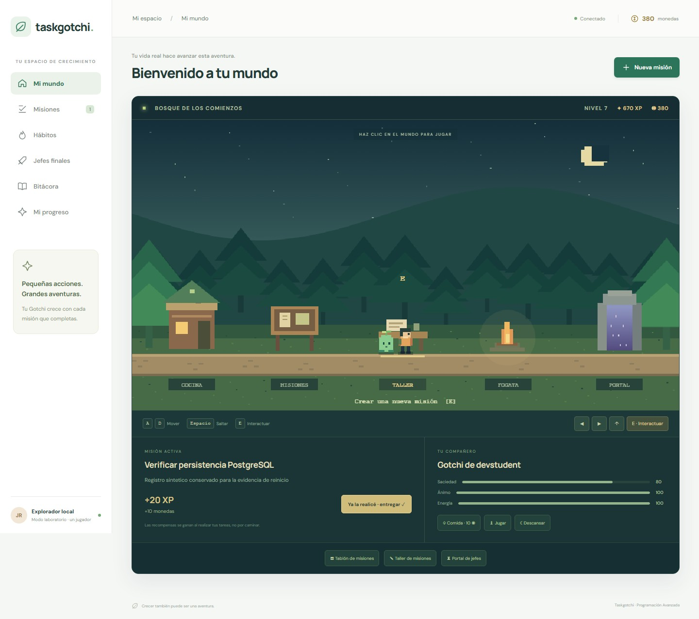
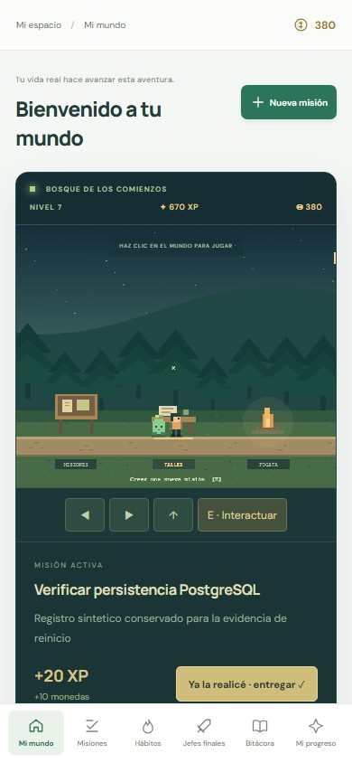
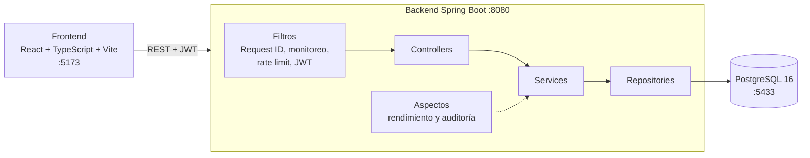
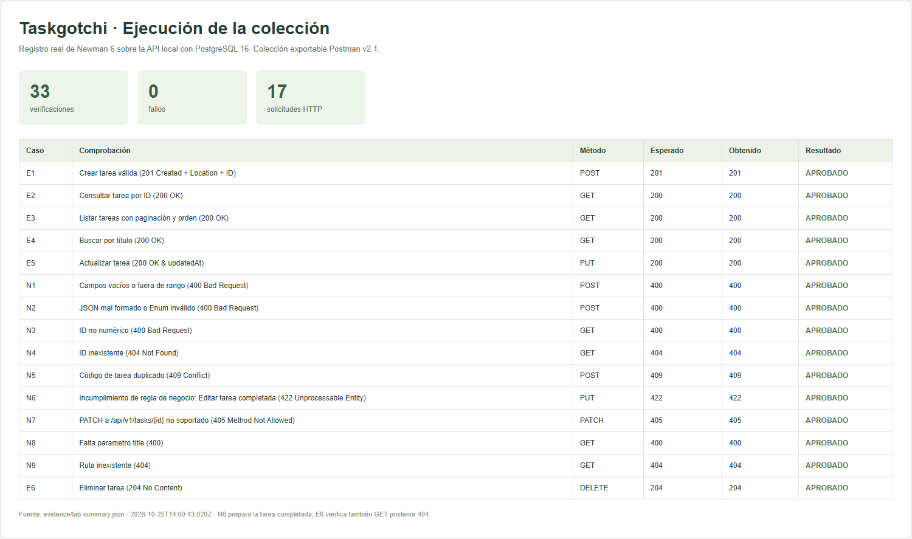
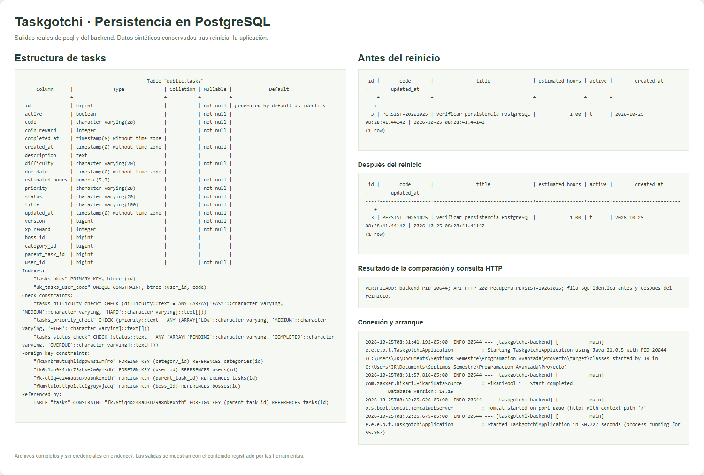

<p align="center">
  
</p>

<h1 align="center">Taskgotchi</h1>

<p align="center">
  Aplicación de productividad para estudiantes que convierte tareas y hábitos en <strong>misiones</strong>.<br/>
  Gana XP y monedas, cuida a tu mascota virtual <strong>Gotchi</strong> y derrota a los <strong>jefes</strong> que representan tus proyectos más grandes.
</p>

<p align="center">
  
  
  
  
  <br/>
  
  
  
  
  
  
</p>

<p align="center">
  
</p>

---

## Concepto

Taskgotchi mezcla un **gestor de tareas** con un **juego de mascota virtual**. Cada tarea real es una misión: al completarla en la vida real y entregarla en la app, ganas experiencia y monedas para cuidar y hacer evolucionar a Gotchi. Los proyectos grandes son jefes cuya vida baja con cada misión asociada que completas.

> Caminar y saltar en el mundo no da recompensas: el progreso solo llega al entregar misiones cumplidas de verdad.

## Funcionalidades

### Mundo 2D
- Bosque dibujado con **Canvas**, donde exploras acompañado de Gotchi.
- Controles: **A/D** o flechas para moverte, **Espacio** para saltar y **E** para interactuar. También hay controles táctiles para móvil.
- Puntos de interacción: **cocina**, **tablón de misiones**, **taller**, **fogata** y **portal**.

### Misiones
- Crear, buscar, filtrar, paginar, editar, completar y eliminar tareas.
- Las tareas vencidas pasan automáticamente a estado `OVERDUE`.
- Recompensas según la dificultad:

| Dificultad | XP | Monedas |
|---|---|---|
| Fácil | 20 | 10 |
| Media | 50 | 25 |
| Difícil | 100 | 60 |

### Hábitos diarios
- Un cumplimiento por día, con **rachas** y bonificación por constancia.

### Mascota Gotchi
- Estadísticas de **saciedad**, **ánimo** y **energía**.
- Cuidados y caricias, **evolución por etapas** y bitácora de eventos.
- Animada en SVG.

### Cocina
- Compra comida con tus monedas, guárdala en la despensa y alimenta a Gotchi.

### Minijuegos
- Arcade con **Catch**, **Echo** y **Memory** para subir el ánimo de la mascota.

### Jefes
- Crea un jefe por proyecto y asóciale misiones. Al derrotarlo obtienes **150 XP y 100 monedas**.

### Más
- **Creador y editor de avatar** para personalizar tu personaje.
- **Asistente** integrado (implementación simulada; no usa IA externa en esta versión).
- **Panel de estadísticas** semanal y **temporizador de enfoque**.
- **Cuentas individuales**: cada estudiante se registra y solo ve sus propios datos.

<p align="center">
  
</p>

## Arquitectura



- Paquete base: `ec.edu.espe.pa.taskgotchi`.
- Arquitectura en capas: **controller → service → repository**, con DTOs y mappers.

### Middlewares y auditoría
- **Filtros:** ID de petición (`X-Request-Id`), monitoreo de peticiones lentas, límite de intentos en login y registro, y validación JWT.
- **Interceptor:** auditoría HTTP de las acciones que modifican datos.
- **Aspectos (AOP):** medición del rendimiento de los servicios y auditoría de negocio con `@Auditable` para recompensas, jefes y mascota.

## Stack tecnológico

| Capa | Tecnología |
|---|---|
| Backend | Java 21, Spring Boot 4.1, Spring MVC, Spring Data JPA, Bean Validation, Spring AOP |
| Seguridad | Spring Security, JWT, rate limiting en autenticación |
| Base de datos | PostgreSQL 16 (perfil `h2` en memoria para demos y CI) |
| Documentación API | springdoc-openapi (Swagger UI) |
| Frontend | React, TypeScript, Vite, Canvas, SVG |
| Pruebas | JUnit, Spring Boot Test, Spring Security Test, Postman + Newman |
| DevOps | Docker Compose, GitHub Actions |

## Estructura del proyecto

```
Taskgotchioriginal/
├── src/main/java/ec/edu/espe/pa/taskgotchi/
│   ├── aspect/          # Auditoría de negocio y rendimiento (AOP)
│   ├── config/          # Seguridad, CORS, OpenAPI, filtros e interceptor
│   ├── controller/      # Auth, tareas, hábitos, mascota, jefes, cocina, dashboard, asistente
│   ├── dto/             # Objetos de petición y respuesta
│   ├── entity/          # Entidades JPA y enums
│   ├── exception/       # Excepciones y manejador global
│   ├── mapper/          # Conversión entidad ↔ DTO
│   ├── repository/      # Repositorios Spring Data
│   ├── security/        # JWT, usuario autenticado, rate limit
│   └── service/         # Lógica de negocio e implementaciones
├── src/test/            # Pruebas unitarias y de integración
├── frontend/src/        # Mundo, auth, avatar, cocina, minijuegos
├── postman/             # Colección y entorno de Postman
├── tools/               # Ejecución de Newman y generación de evidencias
├── scripts/             # start-backend.ps1, start-web.ps1
├── docs/                # Documentación de entrega e imágenes
├── compose.yaml         # PostgreSQL 16
└── .github/workflows/   # CI/CD
```

## Puesta en marcha

### Requisitos previos

- JDK 21
- Node.js 20 o superior
- Docker Desktop

### Ejecución (Windows, PowerShell)

```powershell
# Backend con PostgreSQL (pide la contraseña de la base de datos de forma oculta)
.\scripts\start-backend.ps1

# Backend en modo demo, sin PostgreSQL (H2 en memoria)
.\scripts\start-backend.ps1 -Demo

# Frontend, en otra terminal
.\scripts\start-web.ps1
```

Para detener: `Ctrl + C` en cada terminal y luego `docker stop taskgotchi-postgres`. No borres el volumen `proyecto_taskgotchi-data`, porque ahí están los datos.

### Puertos y URLs

| Servicio | Valor por defecto | Variable |
|---|---|---|
| Interfaz web | http://localhost:5173 | — |
| Backend | http://localhost:8080 | `SERVER_PORT` |
| PostgreSQL | `localhost:5433` | `DB_PORT` |
| Swagger UI | http://localhost:8080/swagger-ui/index.html | — |

El frontend apunta al backend con `VITE_API_BASE_URL`.

### Variables de entorno

| Variable | Descripción | Valor por defecto |
|---|---|---|
| `DB_PASSWORD` | Contraseña de PostgreSQL | Se pide al iniciar |
| `JWT_SECRET` | Clave para firmar los JWT (mínimo 32 caracteres) | Aleatoria en cada arranque |
| `JWT_EXPIRATION_MINUTES` | Duración del token | `120` |
| `AUTH_RATE_LIMIT_MAX` | Intentos permitidos de login/registro | `10` |
| `AUTH_RATE_LIMIT_WINDOW_SECONDS` | Ventana del límite | `60` |
| `DEV_USER_PASSWORD` | Contraseña del usuario de desarrollo `devstudent` | — |
| `SLOW_REQUEST_MS` / `SLOW_METHOD_MS` | Umbrales para registrar peticiones y métodos lentos | `1000` / `500` |

## API

Todas las rutas bajo `/api/v1/**` requieren `Authorization: Bearer <token>`, salvo registro y login. En Swagger UI usa el botón **Authorize**.

| Método | Ruta | Descripción |
|---|---|---|
| `GET` | `/api/v1/tasks` | Listado paginado y búsqueda por título |
| `GET` | `/api/v1/tasks/{id}` | Consultar una misión |
| `POST` | `/api/v1/tasks` | Crear una misión (`201`) |
| `PUT` | `/api/v1/tasks/{id}` | Actualizar una misión |
| `DELETE` | `/api/v1/tasks/{id}` | Eliminar una misión (`204`) |
| `PATCH` | `/api/v1/tasks/{id}/complete` | Completar y entregar las recompensas una sola vez |

Los errores usan un formato uniforme con los códigos `400`, `401`, `404`, `405`, `409`, `422` y `429`. Una misión completada no se puede editar, y una inactiva no se puede completar.

## Pruebas

```powershell
# Backend: pruebas unitarias y de integración
.\mvnw.cmd --batch-mode --no-transfer-progress test

# Frontend: verificación de tipos y build
npm.cmd --prefix frontend run build

# Contrato de la API con Newman
npm.cmd --prefix tools ci --no-audit --no-fund
npm.cmd --prefix tools run lab
```

Los resultados de Newman se guardan en `evidence/newman-run.json` y `evidence/lab-summary.json`.

<p align="center">
  
  
</p>

## CI/CD

El workflow de GitHub Actions se ejecuta en cada push y pull request a `main`:

1. **Backend:** `./mvnw verify` con JDK 21 y empaquetado del JAR.
2. **Frontend:** `npm ci` y `npm run build`.
3. **Contrato de API:** levanta el backend con el perfil `h2` y ejecuta la colección de Postman con Newman.
4. **Release:** al publicar un tag `v*`, crea un GitHub Release con el JAR del backend y el build del frontend.

## Notas

- `ddl-auto=update` se usa solo en el laboratorio. Para producción se recomienda Flyway o Liquibase con `ddl-auto=validate`.
- El multijugador y la IA externa no forman parte de esta versión.
- Más detalles de la entrega en [`docs/ENTREGA.md`](docs/ENTREGA.md).

## Autores

<table align="center">
  <tr>
    <td align="center">
      <a href="https://github.com/Sahid-B">
        <br/>
        <sub><b>Sahid Bosquez</b></sub>
      </a><br/>
      <sub>@Sahid-B</sub>
    </td>
    <td align="center">
      <a href="https://github.com/EMLarco">
        <br/>
        <sub><b>Esteban Larco</b></sub>
      </a><br/>
      <sub>@EMLarco</sub>
    </td>
    <td align="center">
      <a href="https://github.com/Joel3012">
        <br/>
        <sub><b>Jhonny Romero</b></sub>
      </a><br/>
      <sub>@Joel3012</sub>
    </td>
  </tr>
</table>

<p align="center">
  Ingeniería en Tecnologías de la Información — Universidad de las Fuerzas Armadas ESPE
</p>
